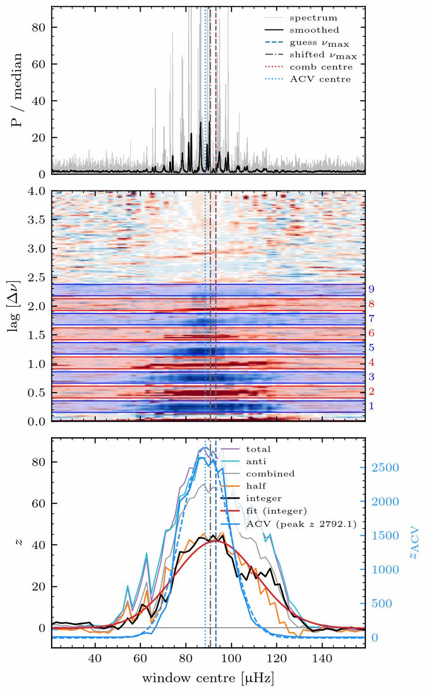
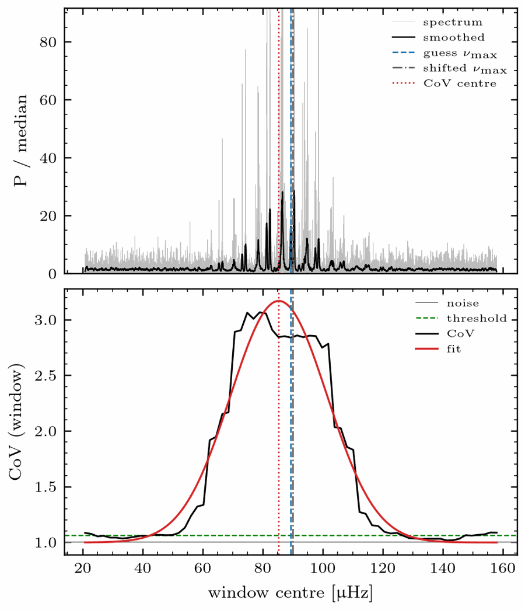
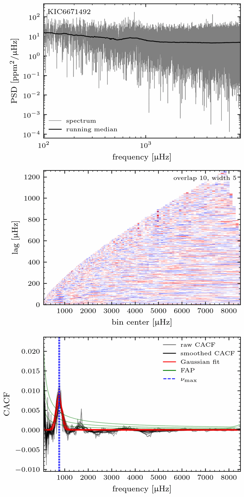
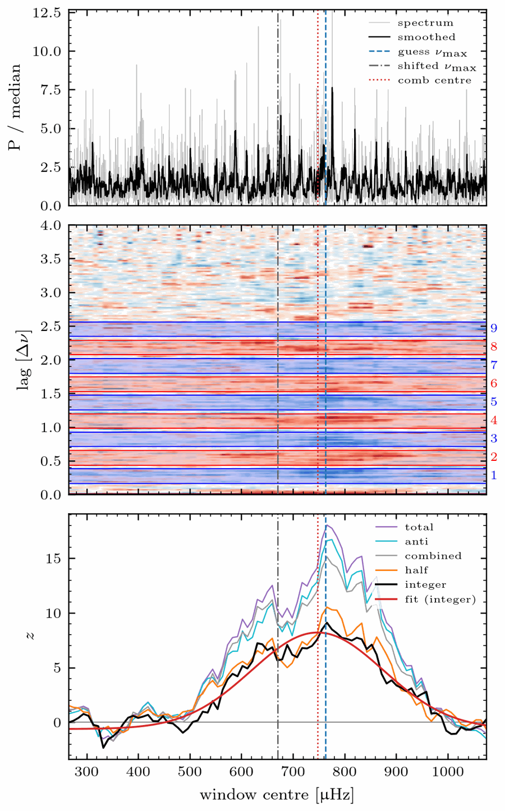
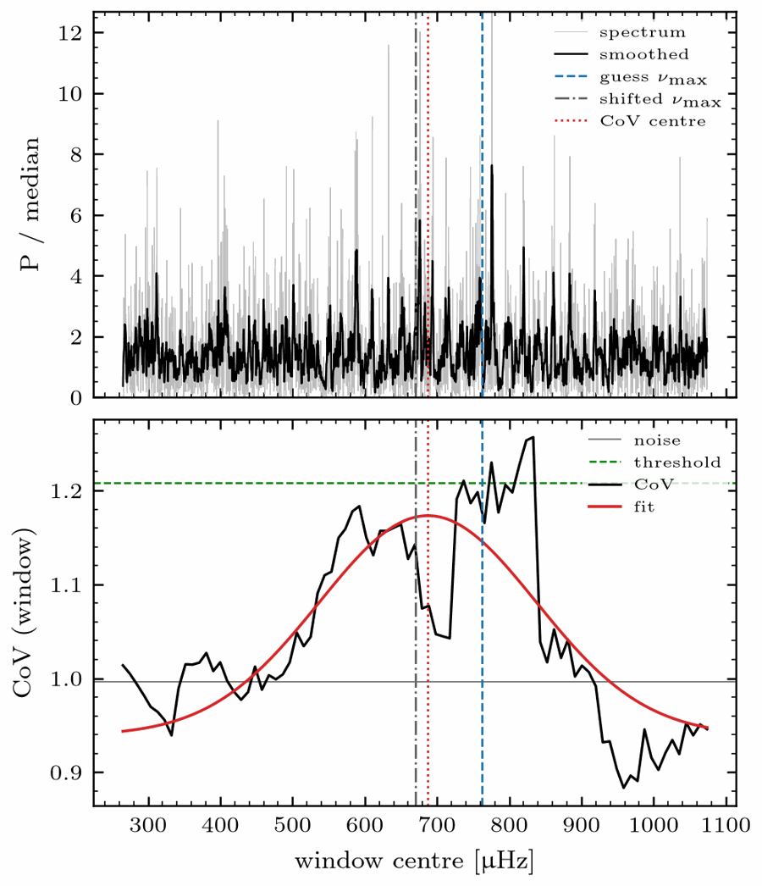

# 🌟 numax_proxies

Estimate **ν<sub>max</sub>**, the frequency of maximum oscillation power of solar-like
oscillators, from a power spectrum or a light curve (Kepler, TESS, or any time series).

Model-independent methods, each run over a grid of binning and smoothing settings:

* **ACF** – collapsed autocorrelation (Huber+2009, Viani+2019): how regular the power is
  within a frequency bin.
* **CoV** – coefficient of variation (Bell+2019, Viani+2019): std / mean of the power in a bin.
* **ACV** (optional) – collapsed autocovariance: the ACF without dividing by the bin's own
  variance, so it responds to regularity and power together.

ν<sub>max</sub> from **scaling relations** (stellar parameters from the YAML file and/or
Gaia DR3) is also available.

> ⚠️ **Known limitations (0.9.0).** Significance is tested per bin (no look-elsewhere
> correction), and the reported uncertainties are formal fit errors, which are too small.

---

## 📦 Installation

```bash
git clone https://github.com/Johanneshj/numax_proxies.git
cd numax_proxies
pip install -e .            # core
pip install -e ".[all]"     # + lightkurve, nifty-ls, astroquery, plot style
pip install -e ".[dev]"     # + pytest
```

Requires Python ≥ 3.12.

---

## 🚀 Quick start

```python
from numax_proxies import NumaxProxies

proxy = NumaxProxies.read_yaml("examples/KIC1872517.yaml").run()
proxy.compute_numax_from_acf()
proxy.compute_numax_from_CoV()
proxy.compute_numax_from_acv()   # optional
proxy.plotting()
print(proxy.results)        # label, numax, numax_err
```

A spectrum already in memory:

```python
proxy = NumaxProxies.from_psd(frequency_muHz, power, {"ACF_CONFIG": {"width_factor": [1, 5]}},
                              target="mystar")
```

Show progress with `logging.basicConfig(level=logging.INFO)`.

**Many stars (e.g. Slurm):** one YAML file per star, one star per task. Set
`CONFIG.n_threads` to the number of CPUs per task.

---

## ⚙️ How it works

1. **Spectrum** – read from a PSD file, or computed from a light curve (file, fits files or
   a lightkurve download) as a Lomb–Scargle PSD in ppm²/µHz.
2. **Normalisation** – divided by a running median (window in units of the envelope FWHM).
3. **Bins** – width = `width_factor` × Δν(ν<sub>c</sub>), step = width / `overlap_scale`,
   with Δν(ν) = 0.267 ν<sup>0.764</sup>.
4. **Statistic per bin**
   * CoV: std / mean.
   * ACF: autocorrelation r(k) normalised by the zero lag, collapsed to one number and with
     its white-noise mean subtracted (white noise ≈ 0):
     * `all_lags` (default): mean |r(k)| over all lags.
     * `delta_nu`: mean r(k) in lag bands around multiples of Δν(ν<sub>c</sub>).
   * ACV: mean |ACF(k)| / n over all lags, not divided by the zero lag, minus its white-noise
     mean. It uses the `ACF_CONFIG` settings. Because it keeps the power, it still finds an
     envelope where a few tall modes dominate a bin and the ACF's r(k) is washed out.
5. **Smoothing** – running mean over `smoothing_factor` × envelope FWHM.
6. **Significance** – each bin is compared with a white-noise threshold (95 % or 99 %) that
   depends only on the number of points in the bin. The thresholds are pre-computed
   (`fap_tables.json`, from `scripts/make_fap_tables.py`); for `delta_nu` they are analytic.
7. **Fit** – a Gaussian to the smoothed curve. The result is the median over the grid.

### 📉 Background correction (optional)

Both methods respond to the oscillation power relative to the background. Where the
background falls with frequency (B ∝ ν<sup>−α</sup>), that ratio peaks above ν<sub>max</sub>, by
α σ²/ν<sub>max</sub> (σ = envelope FWHM / 2.355): typically +5 to +10 % for red giants. With
`background_correction: true` every fitted ν<sub>max</sub> (and the comb-scan centre) is
corrected, ν<sub>max</sub> = ν<sub>p</sub> − α σ²/ν<sub>p</sub>, with α measured from the running
median at ν<sub>p</sub> ± 1.5 FWHM. Where white noise dominates, α ≈ 0 and nothing changes.

### 🔍 Comb scan (optional)

With `comb_scan: true`, each method's final ν<sub>max</sub> is checked for a regular comb:

1. The scan is centred on the **shifted ν<sub>max</sub>**: the peak of P / median smoothed over
   one envelope FWHM within the guess ± `comb_scan_span` FWHM. Windows of constant width
   (`comb_scan_width` × Δν) slide over ± `comb_scan_span` FWHM around it.
2. In each window the autocorrelation is averaged over lag bands m D ± 0.1 D: **integer**
   (m = 1, 2: modes repeating every Δν), **half** (m = ½, 3⁄2), **combined** (all four),
   **anti** (the dips, m = ¼ … 9⁄4, sign flipped) and **total** (peaks plus flipped dips).
   D is the spacing in 0.7–1.3 Δν with the strongest band at lag D.
3. A Gaussian is fitted to each profile. The integer profile decides: its peak must reach
   `comb_scan_threshold` (z ≥ 5: < 1 % false alarms on white noise, also with tall spikes).
   The converged centre (re-scanned until it moves by less than `comb_scan_tolerance` × FWHM)
   becomes the method's ν<sub>max</sub>.
4. Without a significant comb the estimate is rejected: the grid fits are repeated with one
   FWHM around it excluded (`comb_scan_max_refits` times), then ν<sub>max</sub> = NaN.

**ACV check.** The same windows and bands are also collapsed on the autocovariance (the window
ACF not divided by its own variance, in units of the white-noise variance). This separate check
gets its own Gaussian fit. Significant if its peak z ≥ `comb_scan_acv_threshold` (5: ≈ 1 % false
alarms on white noise, but it also responds to tall spikes). It finds envelopes where a few
dominant modes hide the comb. Its centre (background-corrected with `background_correction`) is
reported as `numax_ACVscan_<method>`.

Output: `CombScan_<method>.png` (ACV check on the right axis) and `<target>_comb_scan.txt`.

### 📊 CoV scan (optional)

`cov_scan: true` adds a power-excess check next to the comb scan. It sees envelopes whose comb
is hard to detect (very sharp, mixed or missing modes), but it also responds to tall artefact
spikes, so the two are read together.

1. Centred on the shifted ν<sub>max</sub> as above; windows of constant width
   (`cov_scan_width` × Δν).
2. Per window the CoV (std / mean) of all points of P / median; white noise gives
   z = (CoV − 1 + 1/n) √n ≈ N(0, 1).
3. A Gaussian is fitted to the profile; significant if its peak z ≥ `cov_scan_threshold`
   (3.6: 1 % false alarms per scan on white noise). If not, the grid fits are repeated without
   it (`cov_scan_max_refits` times, on a copy: the methods keep their own fits).

The CoV-scan centres are reported as their own estimates (`numax_CoVscan_ACF`,
`numax_CoVscan_CoV`). Output: `CovScan_ACF.png`, `CovScan_CoV.png`, `<target>_cov_scan.txt`.

### 🔢 Entropy check (optional)

`entropy_check: true` tests each method's ν<sub>max</sub> for a regular spacing (after
Suárez 2022). A window around ν<sub>max</sub> is folded on trial spacings D (an échelle diagram)
and the Shannon entropy H(D) of the folded distribution is computed, for the power (mean
P / median per échelle bin) and for the tallest peaks (2–3 per Δν, at least δν<sub>02</sub>
apart). A dip in H(D) is significant if it is deeper, relative to the star's own median, than in
99 % of white-noise windows. Windows: 8 Δν (power) and 6 Δν (peaks) below ν<sub>max</sub> = 300 µHz,
10 and 8 Δν above. It runs every setting (5–15 bins, every number of peaks) at the initial and the
shifted ν<sub>max</sub> and reports `numax_H<version>_<method>` and `dnu_H<version>_<method>`
(medians over the significant settings; not in `numax_combined`).
Output: `Entropy_<method>.png` and `<target>_entropy_check.txt` (one row per setting).

### 🎯 One estimate

`results` (and `<target>_results.txt`) also hold **`numax_combined`**: the mean of the available
seismic estimates (ACF, CoV and the CoV-scan centres; rejected ones left out), with their spread
(standard deviation) as the uncertainty. The ACV and the ACV-check estimates are reported but not
included.

---

## 🛰️ Kepler short cadence

Kepler SC spectra contain spurious peaks at known frequencies (Van Cleve+2016). Three
optional checks:

* **`artefact_cleaning`** (`Kepler_SC` only) – at each listed artefact, a narrow peak is
  replaced by noise only if it is detected.
* **`exclude_regions`** (any cadence) – fixed frequency ranges replaced by noise. For Kepler
  SC, `[[359, 372]]` removes the broad artefact cluster at 360–370 µHz.
* **`comb_check`** (`Kepler_SC` only) – a fitted ν<sub>max</sub> is kept only if the
  power spectrum of the power spectrum (PSPS) around it has a significant peak near Δν or
  Δν/2. Otherwise the fit is repeated with that region excluded. `near_artefacts` tests only
  fits close to a listed artefact, `always` tests every fit.

---

## 🖼️ Example figures

A red giant (Kepler LC) and a main-sequence star (Kepler SC), with `comb_scan`, `cov_scan` and
`background_correction` on.

* **ACF**: spectrum, 2D ACF, collapsed ACF and the PSPS comb check.
* **CoV**: CoV curves and the PSPS comb check.
* **Comb scan** (of the ACF ν<sub>max</sub>): spectrum segment, local 2D ACF with the lag bands
  (red: correlation, blue: anticorrelation), and the collapsed profiles with the Gaussian fit;
  the ACV check in blue on the right axis.
* **CoV scan** (of the ACF ν<sub>max</sub>): spectrum segment and the CoV per window with the
  noise level, the threshold and the Gaussian fit.

Each grey/black line is one grid setting; dashed blue lines are the fitted ν<sub>max</sub> per
setting, the solid magenta line is the final ν<sub>max</sub> (comb scan, background-corrected).
In the PSPS panel the strongest peak sits at Δν.

| | ACF | CoV | Comb scan | CoV scan |
|---|---|---|---|---|
| **Red giant**, KIC 11612603 (ν<sub>max</sub> = 86.0 µHz) |  |  |  |  |
| **Main sequence**, KIC 6671492 (ν<sub>max</sub> = 728 µHz) |  |  |  |  |

---

## 🔧 Configuration

Every key is optional; unknown keys raise an error, while keys of the original package
(e.g. `use_welch`, `EACF_CONFIG`) are ignored with a warning. Relative paths are relative to
the YAML file. See `examples/KIC1872517.yaml` for a complete file.

### STAR
| key | default | description |
|---|---|---|
| target | null | name (output folders, Gaia, downloads) |
| cadence | null | `Kepler_SC` enables the Kepler SC checks |
| author, quarter, sector, mission | null | lightkurve download |
| logg, teff, radius, mass, luminosity (+ `_err`) | null | for the scaling relations |

### LIGHTCURVE / PSD
`lc_file`, `fits_file_folder`, `psd_file`, `avg_psd_file` (all null).

### CONFIG
| key | default | description |
|---|---|---|
| normalize, sort | true, false | light curve to ppm; sort by time |
| close_gaps, gap_size_days | false, 3.0 | shorten long gaps |
| savgol, savgol_window | false, 90.0 | detrend (window in days) |
| add_noise, noise_std | false, 0.0 | inject white noise (ppm) |
| oversampling | 1.0 | PSD oversampling (> 1 breaks the FAP tables) |
| width_for_wf | null | spectral-window width used for the resolution |
| do_avg_psd | false | averaged PSD (breaks the FAP tables) |
| avg_psd_chunk, avg_psd_overlap, avg_psd_method | 90.0, 0.0, median | chunk [d], overlap, median/mean |
| exclude_regions | [] | `[[lo, hi], ...]` [µHz] replaced by noise at the local level |
| artefact_cleaning | false | Kepler SC: clean detected artefacts |
| artefact_fap, artefact_search_halfwidth, artefact_max_halfwidth | 0.01, 1.0, 3.0 | detection level; search / cleaning half-width [µHz] |
| comb_check | off | Kepler SC: `near_artefacts` or `always` |
| comb_check_fap, comb_check_tolerance, comb_check_distance | 0.01, 0.3, 0.25 | test level; PSPS search range Δν(1 ± tolerance); distance to an artefact [envelope FWHM] |
| comb_scan | false | comb scan of each final ν<sub>max</sub>: re-centre on the comb envelope or reject |
| comb_scan_width, comb_scan_span | 4.0, 2.0 | window width [Δν]; scan range ν<sub>max</sub> ± span × envelope FWHM |
| comb_scan_threshold, comb_scan_tolerance | 5.0, 0.1 | minimum peak z; convergence [envelope FWHM] |
| comb_scan_max_iterations, comb_scan_max_refits | 5, 3 | scans per re-centring; refits after rejections |
| comb_scan_acv_threshold | 5.0 | ACV check in the comb scan: minimum peak z |
| cov_scan | false | CoV scan of each final ν<sub>max</sub>: power-excess check, own estimate |
| cov_scan_width, cov_scan_span | 3.0, 2.0 | window width [Δν]; scan range ± span × envelope FWHM |
| cov_scan_threshold, cov_scan_max_refits | 3.6, 1 | minimum peak z; refits after a non-significant scan |
| entropy_check | false | entropy check of each method's ν<sub>max</sub> (report only) |
| entropy_check_boundary, entropy_check_width_power, entropy_check_width_peaks | 300, [8, 10], [6, 8] | ν<sub>max</sub> [µHz] between giants and the rest; window [Δν] below / above it |
| entropy_check_bins, entropy_check_peaks, entropy_check_peak_gate, entropy_check_fap | 5–15, [2, 3], [null], 0.01 | échelle bins; peaks per Δν of window (range); optional noise cut; false-alarm level |
| background_correction | false | correct each fitted ν<sub>max</sub> for the background slope |
| plot_psps | false | PSPS.png, Δν diagnostic (Δν estimates in `dnu_estimates`) |
| psps_oversampling | 10 | zero padding of the PSPS (plots and Δν only; the test uses independent points) |
| query_gaia | false | Gaia DR3 parameters for the scaling relations |
| initial_numax | null | skip the automatic first guess [µHz] |
| n_threads | null | Numba threads |
| figure_format | png | `png`, `pdf` or `[png, pdf]` |
| random_seed | 42 | |
| plot_lc, save_lc, save_psd, save_avgpsd, save_results | false | outputs |
| results_directory | results | |

### ACF_CONFIG / COV_CONFIG
The ACV method uses `ACF_CONFIG`.

| key | default | description |
|---|---|---|
| min_freq, max_freq | 1.0, null | frequency range [µHz] |
| width_factor | [1] | bin width [Δν] |
| overlap_scale | [5] | bins per bin width |
| smoothing_factor | [1] | smoothing window [envelope FWHM] |
| median_filter_factor | 2 ln 2 | running-median window [envelope FWHM] |
| replace_below_min_freq | false | white noise below min_freq |
| FAP_threshold | 95p0 | `95p0` or `99p0` |
| significance_at_numax | true | require a significant bin within 1 FWHM of the fit |
| plot, plot_log_scale | false | figures |
| plot_comb_check | false | comb-check diagnostic panel (PSPS, oversampled by `psps_oversampling`) |
| save_info, save_results | false | outputs |
| collapse | all_lags | ACF: `all_lags` or `delta_nu` |
| dnu_window, dnu_window_mode | 0.1, relative | ACF `delta_nu`: band half-width, `relative` (1 ± w)·m·Δν or `fixed` (m ± w)·Δν |
| dnu_multiples, dnu_bands | [1], null | ACF `delta_nu`: multiples m of Δν; or B bands at m = 0.5, 1, …, 0.5 B |
| plot_2dacf | false | ACF: 2D ACF panel; `true` or `[overlap_scale, width_factor]` |
| max_acf_fit_iterations, n_sigma_numax_acf | 1, 2.0 | ACF fit |
| use_fallback | true | CoV: weighted mean if no Gaussian fit |

---

## 📁 Outputs

```
<results_directory>/<target>/
  ACF_info/all_data.pkl.gz      every grid setting (curves, FAP, fit)
  ACV_info/all_data.pkl.gz      (ACV method)
  CoV_info/all_data.pkl.gz
  ACF_info/numax_estimates.txt  numax per setting
  figures/                      ACF, ACV, CoVs, PSPS, CombScan_*, CovScan_*, Entropy_*, lc_and_pg, full_spectrum_with_all_estimates
  <target>_results.txt          all estimates, incl. numax_combined
  <target>_comb_scan.txt        comb scan per method (comb_scan: true)
  <target>_cov_scan.txt         CoV scan per method (cov_scan: true)
  <target>_entropy_check.txt    entropy check per method and setting (entropy_check: true)
```

Read a results file with `pickle.load(gzip.open(path))`.

---

## 🧪 Testing

```bash
python -m pytest                       # unit + regression tests
python scripts/injection_test.py       # synthetic stars
python scripts/make_fap_tables.py      # regenerate the FAP tables (~1.5 h)
python scripts/make_entropy_nulls.py   # regenerate the entropy-check thresholds (~5 min on 30 cores)
```

---

## 📚 References

**Methods**
* Huber et al. 2009, CoAst 160, 74 – collapsed ACF, ν<sub>max</sub> from a Gaussian fit (SYD)
* Bell, Hekker & Kuszlewicz 2019, MNRAS 482, 616 – coefficient of variation
* Viani et al. 2019, ApJ 879, 33

**Scaling relations and synthetic spectra**
* Stello et al. 2009, MNRAS 400, L80 – Δν(ν<sub>max</sub>)
* Mosser et al. 2011, A&A 525, L9 – mode pattern
* Mosser et al. 2012, A&A 537, A30 – envelope width; background modelling matters
* Kallinger et al. 2014, A&A 570, A41 – granulation background; background-model systematics in ν<sub>max</sub>

**Δν and comb detection (PSPS, autocorrelation, comb scan)**
* Mosser & Appourchaux 2009, A&A 508, 877 – envelope autocorrelation function, H0 test;
  ν<sub>max</sub> first from where the autocorrelation signal is strongest
* Hekker et al. 2010, MNRAS 402, 2049 – OCT pipeline, PSPS in windows of the spectrum
* Mathur et al. 2010, arXiv:1003.4749 – A2Z pipeline, PSPS on sub-series
* Verner & Roxburgh 2011, arXiv:1104.0631 – windowed autocorrelation of the power-to-background spectrum
* Lund, Chaplin & Kjeldsen 2012, MNRAS 427, 1784 – significance testing of PS⊗PS at low S/N
* Scargle 1982, ApJ 263, 835 – false-alarm probability of the highest of M independent peaks
* Suárez 2022, Front. Astron. Space Sci. 9, 953231 – Shannon entropy of échelle diagrams (entropy check)
* Huber et al. 2010, ApJ 723, 1607 – δν<sub>02</sub> ≈ 0.122 Δν in red giants (peak separation)

**Background and ν<sub>max</sub> systematics**
* Sreenivas & Bedding 2024, MNRAS (arXiv:2401.17557) – ν<sub>max</sub> from the spectrum divided by
  ν<sup>−2</sup>; calibrated 1.5 % offset

**Related pipelines**
* Chontos et al. 2022, arXiv:2108.00582 – pySYD
* Gehan et al. 2023, arXiv:2303.03976 – FRA

**Kepler short cadence**
* Van Cleve et al. 2016 – Kepler data characteristics handbook (artefact frequencies)
