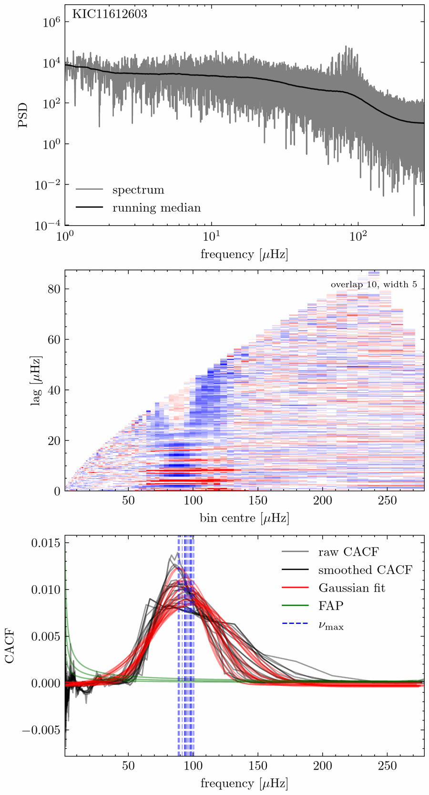
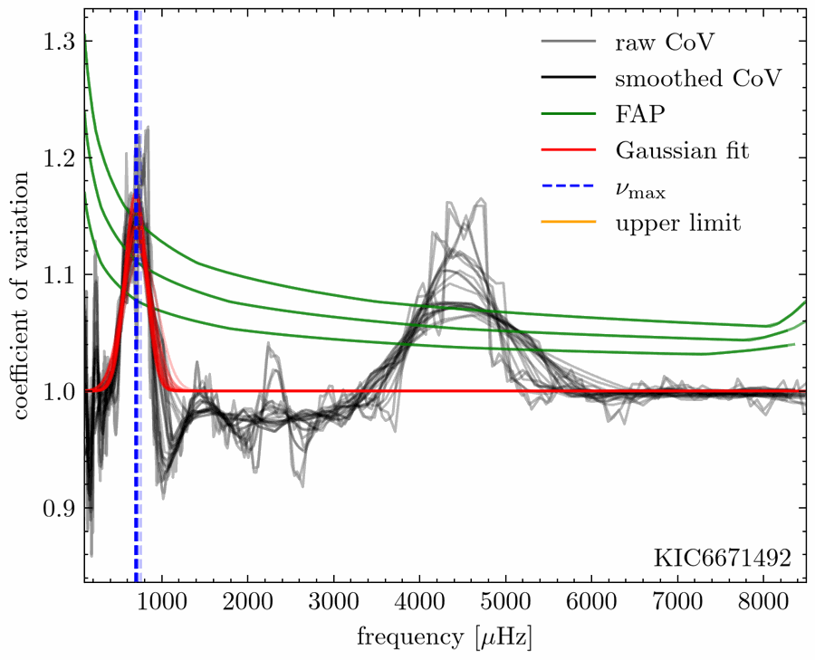

# 🌟 numax_proxies

Estimate **ν<sub>max</sub>**, the frequency of maximum oscillation power of solar-like
oscillators, from a power spectrum or a light curve (Kepler, TESS, or any time series).

Two model-independent methods, each run over a grid of binning and smoothing settings:

* **ACF** – collapsed autocorrelation (Huber+2009, Viani+2019): how regular the power is
  within a frequency bin.
* **CoV** – coefficient of variation (Bell+2019, Viani+2019): std / mean of the power in a bin.

ν<sub>max</sub> from **scaling relations** (stellar parameters from the YAML file and/or
Gaia DR3) is also available.

> ⚠️ **Known limitations (0.6.0).** Significance is tested per bin (no look-elsewhere
> correction), and the reported uncertainties are formal fit errors, which are too small.

---

## 📦 Installation

```bash
git clone https://github.com/Johanneshj/numax_proxies.git
cd numax_proxies
pip install -e .            # core
pip install -e ".[all]"     # + lightkurve, nifty-ls, astroquery, plot style
pip install -e ".[dev]"     # + pytest
```

Requires Python ≥ 3.12.

---

## 🚀 Quick start

```python
from numax_proxies import NumaxProxies

proxy = NumaxProxies.read_yaml("examples/KIC1872517.yaml").run()
proxy.compute_numax_from_acf()
proxy.compute_numax_from_CoV()
proxy.plotting()
print(proxy.results)        # label, numax, numax_err
```

A spectrum already in memory:

```python
proxy = NumaxProxies.from_psd(frequency_muHz, power, {"ACF_CONFIG": {"width_factor": [1, 5]}},
                              target="mystar")
```

Show progress with `logging.basicConfig(level=logging.INFO)`.

**Many stars (e.g. Slurm):** one YAML file per star, one star per task. Set
`CONFIG.n_threads` to the number of CPUs per task.

---

## ⚙️ How it works

1. **Spectrum** – read from a PSD file, or computed from a light curve (file, fits files or
   a lightkurve download) as a Lomb–Scargle PSD in ppm²/µHz.
2. **Normalisation** – divided by a running median (window in units of the envelope FWHM).
3. **Bins** – width = `width_factor` × Δν(ν<sub>c</sub>), step = width / `overlap_scale`,
   with Δν(ν) = 0.267 ν<sup>0.764</sup>.
4. **Statistic per bin**
   * CoV: std / mean.
   * ACF: autocorrelation r(k) normalised by the zero lag, collapsed to one number and with
     its white-noise mean subtracted (white noise ≈ 0):
     * `all_lags` (default): mean |r(k)| over all lags.
     * `delta_nu`: mean r(k) in lag bands around multiples of Δν(ν<sub>c</sub>).
5. **Smoothing** – running mean over `smoothing_factor` × envelope FWHM.
6. **Significance** – each bin is compared with a white-noise threshold (95 % or 99 %) that
   depends only on the number of points in the bin. The thresholds are pre-computed
   (`fap_tables.json`, from `scripts/make_fap_tables.py`); for `delta_nu` they are analytic.
7. **Fit** – a Gaussian to the smoothed curve. The result is the median over the grid.

### 📉 Background correction (optional)

Both methods respond to the oscillation power relative to the background. Where the
background falls with frequency (B ∝ ν<sup>−α</sup>), that ratio peaks above ν<sub>max</sub>, by
α σ²/ν<sub>max</sub> (σ = envelope FWHM / 2.355): typically +5 to +10 % for red giants. With
`background_correction: true` every fitted ν<sub>max</sub> (and the comb-scan centre) is
corrected, ν<sub>max</sub> = ν<sub>p</sub> − α σ²/ν<sub>p</sub>, with α measured from the running
median at ν<sub>p</sub> ± 1.5 FWHM. Where white noise dominates, α ≈ 0 and nothing changes.

### 🔍 Comb scan (optional)

With `comb_scan: true`, each method's final ν<sub>max</sub> is checked and refined:

1. Windows of constant width (`comb_scan_width` × Δν) slide over ν<sub>max</sub> ±
   `comb_scan_span` envelope FWHM. In each window the autocorrelation is averaged over two lag
   bands, at D/2 and D (± 0.1 D); the spacing D is found from the data (0.7–1.3 Δν).
2. A Gaussian is fitted to this profile. Its peak must reach `comb_scan_threshold` (z ≥ 5:
   about 1 % false alarms on white noise).
3. If the Gaussian centre is off, the scan is repeated around it (new Δν) until it moves by
   less than `comb_scan_tolerance` × FWHM. The converged centre becomes the method's
   ν<sub>max</sub>.
4. Without a significant envelope the estimate is rejected: the grid fits are repeated with
   one FWHM around it excluded and the new estimate is scanned (`comb_scan_max_refits`
   times), then ν<sub>max</sub> = NaN.

Output: `CombScan_ACF.png`, `CombScan_CoV.png` and `<target>_comb_scan.txt`.

---

## 🛰️ Kepler short cadence

Kepler SC spectra contain spurious peaks at known frequencies (Van Cleve+2016). Three
optional checks:

* **`artefact_cleaning`** (`Kepler_SC` only) – at each listed artefact, a narrow peak is
  replaced by noise only if it is detected.
* **`exclude_regions`** (any cadence) – fixed frequency ranges replaced by noise. For Kepler
  SC, `[[359, 372]]` removes the broad artefact cluster at 360–370 µHz.
* **`comb_check`** (`Kepler_SC` only) – a fitted ν<sub>max</sub> is kept only if the
  power spectrum of the power spectrum (PSPS) around it has a significant peak near Δν or
  Δν/2. Otherwise the fit is repeated with that region excluded. `near_artefacts` tests only
  fits close to a listed artefact, `always` tests every fit.

---

## 🖼️ Example figures

ACF and CoV for a red giant (Kepler LC) and a main-sequence star (Kepler SC). The ACF
figure shows the spectrum, the 2D ACF, the collapsed ACF and the PSPS comb check; the CoV
figure shows the CoV curves and the PSPS comb check. Each line is one grid setting; dashed
lines are the fitted ν<sub>max</sub>. In the PSPS panel the strongest peak sits at Δν.

| | ACF | CoV |
|---|---|---|
| **Red giant**, KIC 11612603 (ν<sub>max</sub> = 86.0 µHz) |  |  |
| **Main sequence**, KIC 6671492 (ν<sub>max</sub> = 728 µHz) |  |  |

---

## 🔧 Configuration

Every key is optional; unknown keys raise an error, while keys of the original package
(e.g. `use_welch`, `EACF_CONFIG`) are ignored with a warning. Relative paths are relative to
the YAML file. See `examples/KIC1872517.yaml` for a complete file.

### STAR
| key | default | description |
|---|---|---|
| target | null | name (output folders, Gaia, downloads) |
| cadence | null | `Kepler_SC` enables the Kepler SC checks |
| author, quarter, sector, mission | null | lightkurve download |
| logg, teff, radius, mass, luminosity (+ `_err`) | null | for the scaling relations |

### LIGHTCURVE / PSD
`lc_file`, `fits_file_folder`, `psd_file`, `avg_psd_file` (all null).

### CONFIG
| key | default | description |
|---|---|---|
| normalize, sort | true, false | light curve to ppm; sort by time |
| close_gaps, gap_size_days | false, 3.0 | shorten long gaps |
| savgol, savgol_window | false, 90.0 | detrend (window in days) |
| add_noise, noise_std | false, 0.0 | inject white noise (ppm) |
| oversampling | 1.0 | PSD oversampling (> 1 breaks the FAP tables) |
| width_for_wf | null | spectral-window width used for the resolution |
| do_avg_psd | false | averaged PSD (breaks the FAP tables) |
| avg_psd_chunk, avg_psd_overlap, avg_psd_method | 90.0, 0.0, median | chunk [d], overlap, median/mean |
| exclude_regions | [] | `[[lo, hi], ...]` [µHz] replaced by noise at the local level |
| artefact_cleaning | false | Kepler SC: clean detected artefacts |
| artefact_fap, artefact_search_halfwidth, artefact_max_halfwidth | 0.01, 1.0, 3.0 | detection level; search / cleaning half-width [µHz] |
| comb_check | off | Kepler SC: `near_artefacts` or `always` |
| comb_check_fap, comb_check_tolerance, comb_check_distance | 0.01, 0.3, 0.25 | test level; PSPS search range Δν(1 ± tolerance); distance to an artefact [envelope FWHM] |
| comb_scan | false | comb scan of each final ν<sub>max</sub>: re-centre on the comb envelope or reject |
| comb_scan_width, comb_scan_span | 3.0, 2.0 | window width [Δν]; scan range ν<sub>max</sub> ± span × envelope FWHM |
| comb_scan_threshold, comb_scan_tolerance | 5.0, 0.1 | minimum peak z; convergence [envelope FWHM] |
| comb_scan_max_iterations, comb_scan_max_refits | 5, 3 | scans per re-centring; refits after rejections |
| background_correction | false | correct each fitted ν<sub>max</sub> for the background slope |
| plot_psps | false | PSPS.png, Δν diagnostic (Δν estimates in `dnu_estimates`) |
| psps_oversampling | 10 | zero padding of the PSPS (plots and Δν only; the test uses independent points) |
| query_gaia | false | Gaia DR3 parameters for the scaling relations |
| initial_numax | null | skip the automatic first guess [µHz] |
| n_threads | null | Numba threads |
| figure_format | png | `png`, `pdf` or `[png, pdf]` |
| random_seed | 42 | |
| plot_lc, save_lc, save_psd, save_avgpsd, save_results | false | outputs |
| results_directory | results | |

### ACF_CONFIG / COV_CONFIG
| key | default | description |
|---|---|---|
| min_freq, max_freq | 1.0, null | frequency range [µHz] |
| width_factor | [1] | bin width [Δν] |
| overlap_scale | [5] | bins per bin width |
| smoothing_factor | [1] | smoothing window [envelope FWHM] |
| median_filter_factor | 2 ln 2 | running-median window [envelope FWHM] |
| replace_below_min_freq | false | white noise below min_freq |
| FAP_threshold | 95p0 | `95p0` or `99p0` |
| significance_at_numax | true | require a significant bin within 1 FWHM of the fit |
| plot, plot_log_scale | false | figures |
| plot_comb_check | false | comb-check diagnostic panel (PSPS, oversampled by `psps_oversampling`) |
| save_info, save_results | false | outputs |
| collapse | all_lags | ACF: `all_lags` or `delta_nu` |
| dnu_window, dnu_window_mode | 0.1, relative | ACF `delta_nu`: band half-width, `relative` (1 ± w)·m·Δν or `fixed` (m ± w)·Δν |
| dnu_multiples, dnu_bands | [1], null | ACF `delta_nu`: multiples m of Δν; or B bands at m = 0.5, 1, …, 0.5 B |
| plot_2dacf | false | ACF: 2D ACF panel; `true` or `[overlap_scale, width_factor]` |
| max_acf_fit_iterations, n_sigma_numax_acf | 1, 2.0 | ACF fit |
| use_fallback | true | CoV: weighted mean if no Gaussian fit |

---

## 📁 Outputs

```
<results_directory>/<target>/
  ACF_info/all_data.pkl.gz      every grid setting (curves, FAP, fit)
  CoV_info/all_data.pkl.gz
  ACF_info/numax_estimates.txt  numax per setting
  figures/                      ACF, CoVs, PSPS, CombScan_*, lc_and_pg, full_spectrum_with_all_estimates
  <target>_results.txt
  <target>_comb_scan.txt        comb scan per method (comb_scan: true)
```

Read a results file with `pickle.load(gzip.open(path))`.

---

## 🧪 Testing

```bash
python -m pytest                       # unit + regression tests
python scripts/injection_test.py       # synthetic stars
python scripts/make_fap_tables.py      # regenerate the FAP tables (~1.5 h)
```

---

## 📚 References

Bell+2019 (MNRAS 483, 3022) · Huber+2009 (CoAst 160, 74) · Kallinger+2014 (A&A 570, A41) ·
Mosser+2011 (A&A 525, L9) · Mosser+2012 (A&A 537, A30) ·
Stello+2009 (MNRAS 400, L80) · Van Cleve+2016 (Kepler data characteristics handbook) ·
Viani+2019 (ApJ 879, 33)
