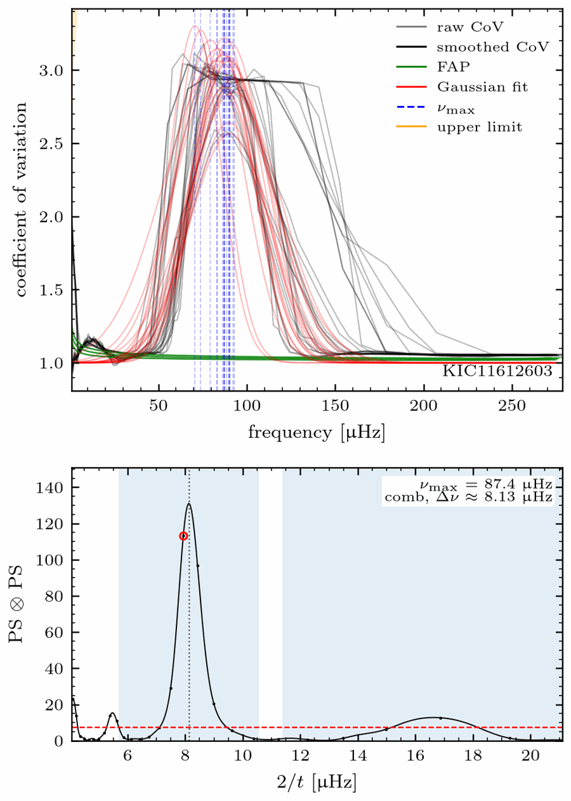

# numax_proxies

Estimate **ν<sub>max</sub>**, the frequency of maximum oscillation power of solar-like
oscillators, from a power spectrum or a light curve (Kepler, TESS, or any time series).

Two model-independent methods are run over a grid of binning and smoothing settings:

| method | statistic per frequency bin | white noise gives |
|---|---|---|
| **ACF** – collapsed autocorrelation (Huber+2009, Viani+2019) | autocorrelation of the relative power (regularity within the bin), minus its white-noise mean | ≈ 0 |
| **CoV** – coefficient of variation (Bell+2019, Viani+2019) | std / mean of the power | ≈ 1 |

The package also gives ν<sub>max</sub> from **scaling relations** with stellar parameters from
the YAML file and/or Gaia DR3.

> **Known limitations (version 0.4.0).** The significance test is per bin (no
> look-elsewhere correction), and the reported uncertainties are formal fit errors, which
> are too small.

---

## Installation

```bash
git clone https://github.com/Johanneshj/numax_proxies.git
cd numax_proxies
pip install -e .            # core: PSD files -> ACF + CoV
pip install -e ".[all]"     # + light-curve downloads/fits (lightkurve), averaged PSD
                            #   (nifty-ls), Gaia queries (astroquery), plot style
pip install -e ".[dev]"     # + pytest
```

Requires Python ≥ 3.12.

## Quick start

```python
from numax_proxies import NumaxProxies

proxy = NumaxProxies.read_yaml("examples/KIC1872517.yaml").run()
proxy.compute_numax_from_acf()      # median over the grid, ufloat(numax, error)
proxy.compute_numax_from_CoV()
proxy.plotting()                    # spectrum with all estimates
print(proxy.results)                # DataFrame: label, numax, numax_err
```

Or run `python examples/run_example.py` from any folder; the output goes to `./results_example/`.

A spectrum that is already in memory:

```python
proxy = NumaxProxies.from_psd(frequency_muHz, power,
                              {"ACF_CONFIG": {"width_factor": [1, 5]}}, target="mystar")
proxy.compute_numax_from_CoV()
proxy.cov.results          # every grid setting: curves, FAP, fit
```

Logging is silent by default; to see progress:
```python
import logging; logging.basicConfig(level=logging.INFO)
```

### Many stars (Slurm)

Write one YAML file per star, then run one star per array task:

```python
# run_one.py
import sys
from numax_proxies import NumaxProxies
p = NumaxProxies.read_yaml(f"config_files/{sys.argv[1]}.yaml").run()
p.compute_numax_from_acf(); p.compute_numax_from_CoV()
```

Set `CONFIG.n_threads` (or the environment variable `NUMBA_NUM_THREADS`) to the number of
CPUs per task.

---

## What the pipeline does

### 1. Spectrum
The spectrum comes from the first of these that is given:
1. `PSD.psd_file`: frequency [µHz], power (`.parquet`, `.csv`, `.txt`, `.pow`, `.ftr`)
2. `PSD.avg_psd_file`
3. `LIGHTCURVE.lc_file`: time [d], flux, flux_err (`.parquet`, `.csv`, `.ftr`)
4. `LIGHTCURVE.fits_file_folder`: Kepler `kplr<KIC>*` or TESS `*<TIC>*` fits files
5. a lightkurve download of `STAR.target`

A light curve is optionally sorted, normalised to ppm, gap-shortened, injected with noise
and Savitzky–Golay detrended (in that order). Its Lomb–Scargle PSD is calibrated with
Parseval's theorem to ppm²/µHz. With `do_avg_psd`, an average of Hann-windowed PSDs of
(overlapping) chunks is used instead, either the median or the mean of the chunks.

Kepler short-cadence spectra (`clean_kepler_sc`) have known spurious peaks
(Van Cleve+2016) replaced by noise.

### 2. Normalisation
Below `min_freq` the PSD is optionally replaced by χ²₂ white noise at the local level
(`replace_below_min_freq`). The PSD is then divided by a running median whose window is
`median_filter_factor` × the envelope FWHM, 0.66 ν<sup>0.88</sup> (Mosser+2012):

* ACF: relative power x = (P − median) / median
* CoV: x = P / median

### 3. Bins
Bins follow the expected large separation, Δν(ν) = 0.267 ν<sup>0.764</sup> (Stello+2009):

* bin width = `width_factor` × Δν(ν<sub>c</sub>)
* step between bin centres = width / `overlap_scale`
* first centre = `min_freq`; the last bin ends at `max_freq`, or at the end of the spectrum

### 4. Statistic per bin
* **CoV**: sample standard deviation (ddof = 1) / mean.
* **ACF**: the autocorrelation r(k) = ACF(k)/ACF(0), with ACF(k) = Σ x<sub>j</sub>x<sub>j+k</sub>
  of the centred x. Dividing by the zero lag removes the scale of the power, so r(k) measures
  regularity within the bin, not its variance. It is collapsed to one number by `collapse`,
  and the white-noise mean of that number is subtracted, so white noise gives ≈ 0 in every
  bin, whatever its size:
  * `all_lags` (default): mean |r(k)| over all lags 1 … n−1 (Viani's MCC) minus μ<sub>0</sub>(n).
    For white noise mean |r| ≈ 0.53/√n; μ<sub>0</sub>(n) is taken from the simulations behind the
    FAP tables.
  * `delta_nu`: r(k), signed, averaged over the lags within ±`dnu_window` of
    m·Δν(ν<sub>c</sub>) for each m in `dnu_multiples` (how strongly the spectrum repeats at the
    Δν expected if ν<sub>max</sub> were at the bin centre), minus its white-noise mean. For
    white noise r(k) has mean −(n−k)/n² and variance (n−k)/n², lags ~independent, so mean
    and threshold are analytic (threshold z·σ). Bins must be wider than
    (1 + `dnu_window`)·max(m) Δν.

### 5. Smoothing
Running mean of the binned curve over `smoothing_factor` × envelope FWHM.

### 6. Significance
The raw (unsmoothed) statistic of each bin is compared with a white-noise threshold.
`FAP_threshold` sets the level per bin: `95p0` or `99p0`.
The threshold depends only on the number of points N in the bin:
`src/numax_proxies/fap_tables.json` holds the 95th and 99th percentiles for N = 4, 8, …, 65536,
each from 10⁶ simulated bins of independent χ²₂ noise (`scripts/make_fap_tables.py`), and for
the ACF also μ<sub>0</sub>(N). A bin's threshold is interpolated at its actual N (ACF: in log–log,
since the values fall ∝ N<sup>−1/2</sup>). Bins with N < 4 are never significant. `delta_nu`
needs no table (analytic).

The thresholds are **per bin**: in a spectrum with many bins, noise exceeds one of them
somewhere by chance (look-elsewhere effect).
With `significance_at_numax: true` a fit is only kept if a significant bin lies within
one envelope FWHM of the fitted ν<sub>max</sub>.

### 7. Fit
* **ACF**: a Gaussian with an offset, fitted to the smoothed CACF. With
  `max_acf_fit_iterations` > 1, the fitted peak is removed and the curve fitted again; the
  fit with the largest integral within ±`n_sigma_numax_acf` σ is kept.
* **CoV**: the initial ν<sub>max</sub> is the highest smoothed CoV among the significant
  bins. A Gaussian on an offset of 1 is fitted within ±1 FWHM of it, and fits whose peak CoV
  exceeds 2.69 ν<sup>0.154</sup> are rejected. If no fit is possible, a CoV-weighted mean
  frequency is used (`use_fallback`). Every setting records `fit_type`: gaussian, fallback,
  rejected, not_significant (see `significance_at_numax`) or none.

The reported value is the median over all grid settings with a finite numax and error.
The error is the median of the formal fit errors, which are too small.

---

## Example figures

ACF (`collapse: delta_nu`, with the 2D ACF panel, `plot_2dacf: [10, 5]`) and CoV of a red
giant and a main-sequence star, for widths 3, 5, 10, overlaps 5, 10 and smoothing factors
0.5, 1, 1.5, with `significance_at_numax: true`. Each line is one grid setting; dashed lines are the fitted ν<sub>max</sub>.
In the 2D ACF, red is correlated, white is white noise and black is anticorrelated; the
dotted lines are the `delta_nu` lag window (1 ± `dnu_window`) Δν(ν<sub>c</sub>).

| | ACF | CoV |
|---|---|---|
| **Red giant**, KIC 11612603 (APOKASC-3 ν<sub>max</sub> = 86.0 µHz; ACF 91.1, CoV 87.4) |  |  |
| **Main sequence**, KIC 6671492 (Sayeed et al. ν<sub>max</sub> = 728 µHz; ACF 770, CoV 699) |  |  |

## Configuration reference

Every key is optional. Unknown keys raise an error. Keys from older versions that have no
effect are accepted with a warning (`plot_all_estimates`, `sliding_window_style`,
`use_linear_bins`, the `EACF_CONFIG` section).
Relative input paths are resolved relative to the YAML file. See
`examples/KIC1872517.yaml` for a complete file.

**STAR**
| key | default | |
|---|---|---|
| target | null | name, used for output folders, Gaia, downloads |
| cadence | null | `Kepler_SC` switches on `clean_kepler_sc` by default |
| author, quarter, sector, mission | null | lightkurve download |
| logg, teff, radius, mass, luminosity (+ `_err`) | null | lists, one value per source |

**LIGHTCURVE / PSD**: `lc_file`, `fits_file_folder`, `psd_file`, `avg_psd_file` (all null).

**CONFIG**
| key | default | |
|---|---|---|
| normalize | true | flux → ppm relative to the median |
| sort | false | sort, drop duplicate times, start at t = 0 |
| close_gaps, gap_size_days | false, 3.0 | shorten gaps longer than gap_size_days to that length |
| savgol, savgol_window | false, 90.0 | subtract a Savitzky–Golay trend (window in days) |
| add_noise, noise_std | false, 0.0 | inject white noise (ppm) |
| oversampling | 1.0 | PSD oversampling (breaks the FAP assumptions if > 1) |
| width_for_wf | null | width of the spectral window used for the resolution |
| weight_psd_by_flux_err | false | true: old normalisation, (flux/flux_err)² |
| do_avg_psd | false | use the averaged PSD (breaks the FAP assumptions) |
| avg_psd_chunk, avg_psd_overlap, avg_psd_method | 90.0, 0.0, median | chunk length [d], overlap fraction, median/mean |
| clean_kepler_sc | null | null: on for cadence `Kepler_SC`; true/false to force |
| query_gaia | false | Gaia DR3 Teff, logg, M, R, L for the scaling relations |
| initial_numax | null | skip the automatic first guess (µHz) |
| n_threads | null | Numba threads (null: Numba default) |
| random_seed | 42 | every random number in the pipeline |
| plot_lc, save_lc, save_psd, save_avgpsd, save_results | false | outputs |
| results_directory | results | relative to the working directory |

**ACF_CONFIG / COV_CONFIG**
| key | default | |
|---|---|---|
| min_freq, max_freq | 1.0, null | µHz |
| overlap_scale | [5] | bins per bin width |
| width_factor | [1] | bin width in Δν |
| smoothing_factor | [1] | smoothing window in envelope FWHM |
| median_filter_factor | 2 ln 2 | running-median window in envelope FWHM |
| replace_below_min_freq | true | white noise below min_freq |
| FAP_threshold | 95p0 | 95p0 or 99p0 (per bin) |
| collapse | all_lags | ACF only: `all_lags` or `delta_nu` |
| dnu_window, dnu_multiples | 0.1, [1] | ACF `delta_nu`: lag window (fraction of Δν), multiples of Δν |
| plot_2dacf | false | ACF only: 2D ACF panel in ACF.png (lag vs bin centre; lag in Δν(ν<sub>c</sub>) for `delta_nu`, in µHz for `all_lags`); `true` = first grid setting, or `[overlap_scale, width_factor]` |
| significance_at_numax | false | true: a significant bin must lie within 1 FWHM of the fitted numax |
| plot, plot_log_scale | false | figures |
| save_info | false | `all_data.pkl.gz` with every grid setting |
| save_results | false | `numax_estimates.txt` |
| max_acf_fit_iterations, n_sigma_numax_acf | 1, 2.0 | ACF only |
| use_fallback | true | CoV only |

## Outputs
```
<results_directory>/<target>/
  ACF_info/all_data.pkl.gz      {(overlap_scale, width_factor, smoothing_factor): {
  CoV_info/all_data.pkl.gz         bin_centers, N_data_points_in_bin, cacf_raw | cov,
                                   cacf_smoothed | cov_smoothed, fap, fit_numax (ufloat),
                                   fit_params, fit_type (CoV)}}
  ACF_info/numax_estimates.txt  numax, numax_err per setting
  figures/                      ACF.png, CoVs.png, lc_and_pg.png, full_spectrum_with_all_estimates.png
  <target>_results.txt          CONFIG.save_results
  PSD_<target>.parquet, AvgPSD_<target>.parquet, data/LC_<target>.parquet
```
Read a results file with `pickle.load(gzip.open(path))`.

## Layout
```
src/numax_proxies/
  pipeline.py      NumaxProxies (input -> estimates -> outputs)
  config.py        YAML sections as dataclasses, validation
  io.py            file reading/writing
  lightcurve.py    light-curve sources and processing
  spectrum.py      periodogram, averaged PSD, Kepler SC cleaning
  seismic.py       Delta-nu(nu), envelope FWHM(nu), CoV limit, numax scaling relations
  binning.py       white-noise replacement, running median, bins, smoothing
  significance.py  FAP thresholds (fap_tables.json)
  fitting.py       Gaussian models
  methods/         acf.py, cov.py, scaling.py
  gaia.py, plotting.py, synthetic.py, threads.py
scripts/           make_fap_tables.py, injection_test.py
tests/             pytest (python -m pytest)
examples/          KIC1872517 light curve + documented YAML
docs/figures/      example figures (README)
```

## Testing and validation
```bash
python -m pytest                       # unit + regression tests (~5 s)
python scripts/injection_test.py       # synthetic stars: detection rate, accuracy, false alarms
python scripts/make_fap_tables.py      # regenerate the FAP tables + violin plots (~1.5 h)
```
`synthetic.py` builds Kepler-like spectra with a known ν<sub>max</sub>: granulation
background, a Gaussian envelope, an l = 0, 1, 2 mode comb and χ²₂ noise.

## References
Bell+2019 (MNRAS 483, 3022) · Huber+2009 (CoAst 160, 74) · Kallinger+2014 (A&A 570, A41) ·
Mosser+2011 (A&A 525, L9) · Mosser+2012 (A&A 537, A30) · Stello+2009 (MNRAS 400, L80) ·
Van Cleve+2016 (Kepler data characteristics handbook) · Viani+2019 (ApJ 879, 33)
